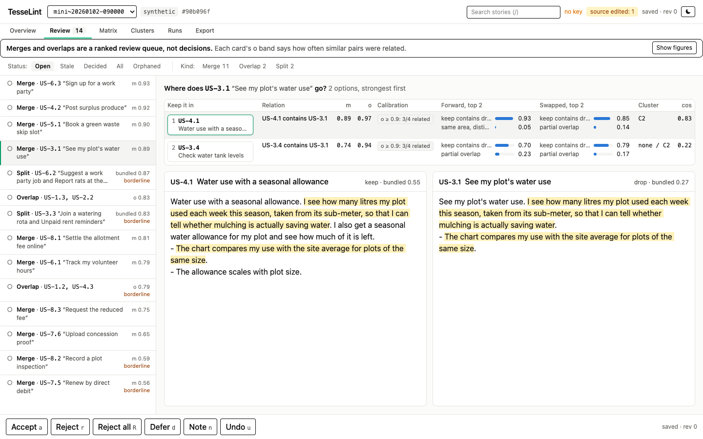
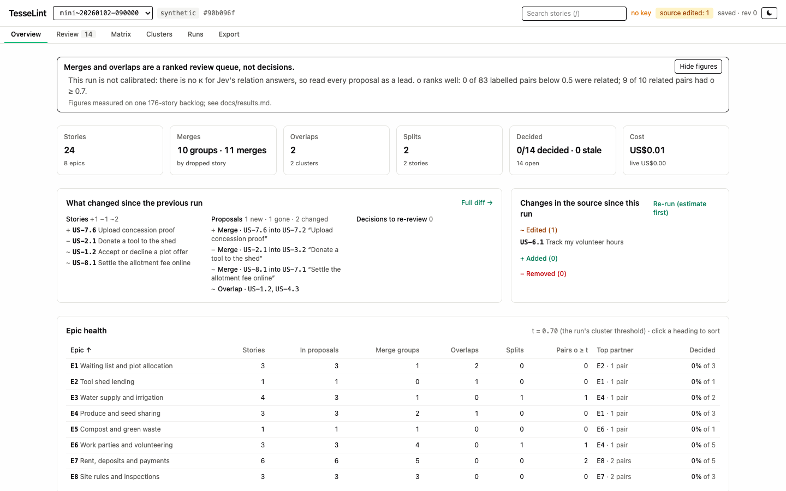

# TesseLint

TesseLint finds duplicate, overlapping and bundled user stories in a backlog. It asks Jev, a decision model on OpenRouter, how every pair of stories relates and whether each story asks for more than one thing, then ranks merges, overlaps and splits for you to review in a local web UI. It never edits your backlog.

The name comes from tessellation: tiles that cover a surface without overlapping. A tidy backlog should look like that.

[](https://github.com/Romain-Jochum/tesselint/actions/workflows/ci.yml) [](LICENSE) [](https://www.python.org/downloads/)



## Quick start, no key needed

You need Python 3.12 and [uv](https://docs.astral.sh/uv/). The repository ships two synthetic runs of 24 made-up stories, so you can try the review UI without a key and without spending anything:

```sh
git clone https://github.com/Romain-Jochum/tesselint.git && cd tesselint
uv sync
uv run tesselint serve --runs tests/fixtures/ui/runs --source tests/fixtures/ui/source.v1.json
```

This opens `http://127.0.0.1:8765/`. Nothing calls Jev, and your decisions go to `.tesselint/`.

To get the `tesselint` command on your path instead, install it as a uv tool:

```sh
uv tool install git+https://github.com/Romain-Jochum/tesselint
```

## What leaves your machine

When you run `tesselint run` without `--dry-run`, the text of every story goes to OpenRouter and to Typesafe, the provider that serves Jev. Read [OpenRouter's privacy policy](https://openrouter.ai/privacy) and [Typesafe's page on OpenRouter](https://openrouter.ai/typesafe) before you send a confidential backlog. Everything else (`parse`, `import`, `export`, dry runs and the review UI) stays local, and the UI listens on loopback only.

## Use it on your own backlog

Put your OpenRouter key in a `.env` file, which git ignores, then parse, estimate, run and review:

```sh
cp .env.example .env                                   # then set OPENROUTER_API_KEY
uv run tesselint parse --source backlog.md             # counts the stories it can read
uv run tesselint run --source backlog.md --dry-run     # the estimate: no call, no key
uv run tesselint run --source backlog.md               # asks Jev; stops at US$1 by default
uv run tesselint serve --source backlog.md             # review the proposals
```

Always run `--dry-run` first. It prints how many questions a run would ask and what they would cost, and it calls nothing.

**Markdown input.** Epics are `### E<n> Name` headings and stories are `- **US-<n>.<m> Title.**` bullets. If the file has a `## 4.` section, only that section is read. The first `[…]` after a title is its tag, and nested bullets and table rows become details:

```markdown
### E1 Membership

- **US-1.1 Sign up with a phone number [MVP].** I join with my phone number, so that I can borrow without a password.
  - The code expires after ten minutes.
- **US-1.7 Single sign-on [MVP]** — merged into US-1.1: one sign-in path is enough.
- **US-4.6 Automatic fines** — removed: they put people off.
```

[`tests/fixtures/sample_backlog.md`](tests/fixtures/sample_backlog.md) shows every variant the parser reads. A file in another shape exits 4 with a message that says what was expected.

**JSON input.** Any `.json` source is read as stories v1, a validated format described in [`docs/input/INPUT.md`](docs/input/INPUT.md) with its schema in `schemas/`. `tesselint import backlog.md --out stories.json` converts the Markdown shape above, word for word, and `tesselint export` turns it back. For anything else (a tracker export, a spreadsheet), INPUT.md §5 has a prompt you can paste into an LLM to do the conversion.

The other commands: `report RUN_DIR` rebuilds a run's proposals offline with other thresholds, `synth` and `eval` build and score a synthetic set with planted answers, and `key` shows whether your key is set and its balance. Every command has `--help`, and `tesselint --version` prints the version. Exit codes: 0 ok, 1 unexpected, 2 usage, 3 spend cap, 4 bad input, 5 Jev refused, 6 too many failed calls, 130 interrupted.

## Costs

Jev bills input tokens only, at US$0.042 per million, and returns a probability for each option it was offered. A run asks one question per pair of stories and one per story, so cost grows with the number of pairs, n(n−1)/2, at about US$0.035 per 1,000 pairs:

| Stories | Pairs | Cost, nothing cached | Time |
|---|---|---|---|
| 176 | 15,400 | US$0.54 (measured) | about 6 min |
| 500 | 124,750 | about US$4.4 | about 50 min |
| 1,000 | 499,500 | about US$17.5 | about 3 h |

The default spend cap is US$1: a run whose estimate is higher stops before any call and exits 3. Raise it with `--max-usd` or `TESSELINT_MAX_USD`. Answers are cached by the exact texts, so a re-run pays only for the stories you edited; one edited story out of 176 cost US$0.006.

## Scope

TesseLint was built and measured on user stories, and its questions ask about "user story A" and "user story B". Requirements, tickets or test cases can go through the JSON input, but nobody has measured how well it does on them.

## How far to trust it

On one 176-story backlog, a blind LLM labeller checked 160 pairs. Jev's split question passed (precision 0.67 at 0.8, AUC 0.82). Its relation question failed as a classifier (κ 0.08 to 0.15): Jev calls overlap and containment far more often than the labeller did. The overlap probability still ranks well: no labelled pair below 0.5 was related, and 9 of the 10 related pairs scored 0.7 or more.

So treat the proposals as a ranked review queue, not verdicts. The CLI cuts overlap clusters at 0.7, a calibrated run's `proposals.md` marks a failed question as not trusted, and the UI keeps a trust banner on the Overview and Review screens. The figures, the synthetic scores and the known limits are in [`docs/results.md`](docs/results.md).

## How it works

1. **Parse.** Read the stories from the Markdown or JSON source and freeze a hashed snapshot of it.
2. **Ask.** For each pair, one Jev question with directional options: duplicate, A contains B, B contains A, partial overlap, same area, unrelated. Pairs with an overlap signal are asked again in the swapped order, because Jev is order-biased. Each story also gets one question on whether it bundles several capabilities.
3. **Cache.** Answers are keyed by the question, the model and the exact texts.
4. **Propose.** Merges, overlap clusters (average linkage) and splits, each with its evidence and a borderline flag, go to `runs/<id>/proposals.md` and `proposals.json`, next to the raw answers, `matrix.csv` and `run.json`.
5. **Review.** `tesselint serve` shows the runs: an overview with epic health and what changed since the previous run, one review case at a time with both texts side by side (keys `a` accept, `r` reject, `d` defer, `n` note, `u` undo), an epic or story heatmap, a diff between runs, a capped re-run and an export of your decisions as instructions for whoever edits the backlog.



The design is in [`docs/DESIGN.md`](docs/DESIGN.md) (CLI and pipeline) and [`docs/ui/DESIGN.md`](docs/ui/DESIGN.md) (web UI).

## The embedding model

Each run also computes a local similarity between stories with the model2vec model `minishlab/potion-retrieval-32M`, for the logs and the optional `--prefilter` shortlist. The first run downloads it from Hugging Face (131 MB, once). To fetch it ahead of time, or before running the slow tests:

```sh
uv run python -c "from model2vec import StaticModel; StaticModel.from_pretrained('minishlab/potion-retrieval-32M')"
```

The demo in the quick start does not need it.

## Development

Node is only needed to work on the UI: the built assets are committed, so installing needs none.

```sh
uv run ruff check . && uv run ruff format --check . && uv run mypy src tests
uv run pytest -q                              # includes slow, excludes live
uv run pytest -q -m "not live and not slow"   # fast
uv run pytest -m live -q                      # real Jev calls: costs money
npm --prefix web ci && npm --prefix web run typecheck && npm --prefix web run test
npm --prefix web run build                    # rewrites the committed UI assets
npm --prefix web run e2e                      # Playwright, needs Google Chrome
```

Tests run offline against fakes and a synthetic backlog. See [`CONTRIBUTING.md`](CONTRIBUTING.md) and [`SECURITY.md`](SECURITY.md).

## License

MIT, see [`LICENSE`](LICENSE).
